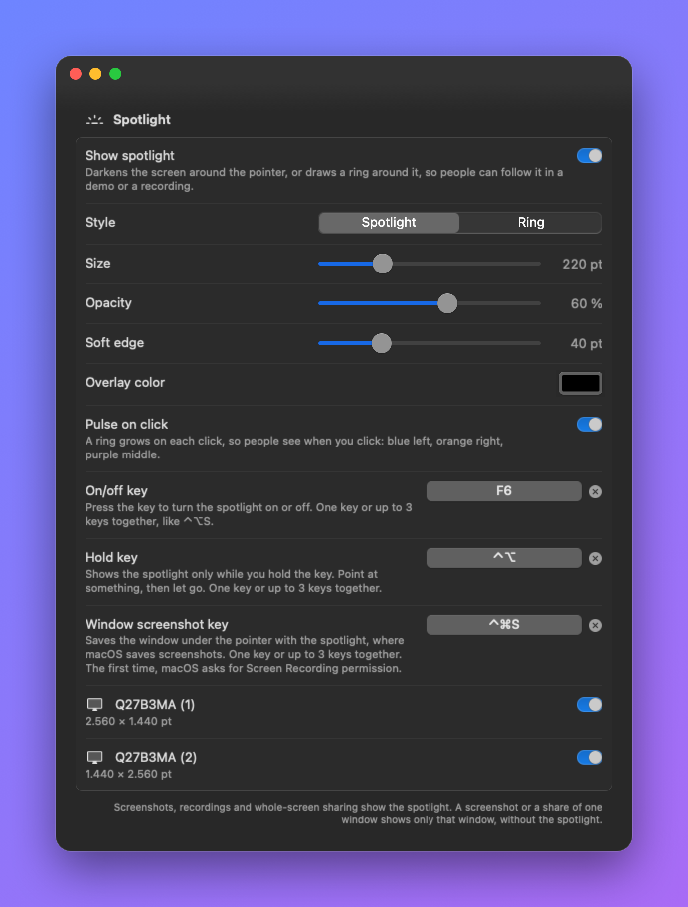
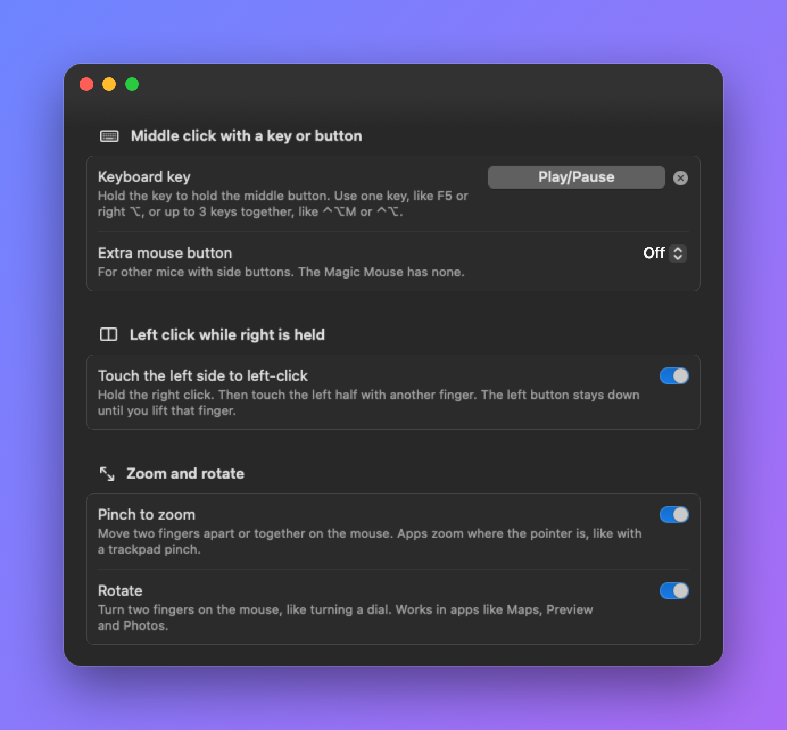

<p align="center">
  
</p>

<h1 align="center">MagicClick</h1>

<p align="center">
  <b>Middle click, chord click, pinch to zoom, rotate and a pointer spotlight for the Apple Magic Mouse.</b><br>
  A tiny, free and open-source menu bar app for macOS.
</p>

<p align="center">
  
  
  
</p>

---

The Magic Mouse has one physical button. macOS looks at where your finger is and decides if a press is a left or a right click. That leaves two gaps:

1. **There is no middle click.** You need it to open links in a new tab, close tabs, paste on Linux machines over remote desktop, pan in Blender, CAD and map apps, and more.
2. **You cannot left-click while you hold the right button.** The button is already down, so a second press is impossible. Games and some pro apps need this "chord".

MagicClick fixes both. It reads your fingers on the touch surface of the mouse and turns the right gestures into the right clicks.

<p align="center">
  
</p>

<p align="center">
  
  
</p>

## Features

### Middle click
- **Click with fingers** – Press the mouse with 3 fingers on it (2, 3 or 4, you choose). Hold and move to middle-drag.
- **Tap with fingers** – Optional. Tap with 3 fingers without pressing.
- **Keyboard key** – Pick any key to act as the middle button. Hold the key and move the mouse to middle-drag. It works with:
  - normal keys and shortcuts, for example `F13` or `⌥F5`
  - a modifier on its own, for example **Right ⌥ Option**, **Right ⌘ Command** or **fn / 🌐**
  - media and special keys, for example **Play/Pause**, **Mute** or **Volume Up**
  - Mission Control, Spotlight, Dictation and other top-row keys
- **Extra mouse button** – For other mice: turn button 4 or button 5 into a middle click.
- **Also on trackpad** – Optional. Use the same finger click and tap on your trackpad.

### Left click while the right button is held
Hold the right click. Then touch the **left half** of the mouse with another finger. MagicClick sends a left button press. The left button stays down until you lift that finger, so you can click or hold.

Fingers that were already on the mouse when you pressed the right button are ignored. A finger that lands on the right half is ignored too, even if it slides left.

### Pinch to zoom and rotate
- **Zoom** – Move two fingers apart or together on the mouse, like a pinch on the trackpad. It works in Safari, Preview, Photos, Maps, most browsers and other apps that support trackpad pinch.
- **Rotate** – Turn two fingers on the mouse, like turning a dial. It works in Maps, Preview, Photos and other apps that support trackpad rotation.

MagicClick sends the same gesture events that a trackpad sends, so apps zoom and rotate **where the pointer is**. The larger movement decides: a spread zooms, a turn rotates. Spread clearly while you turn to do both at the same time.

Two fingers that slide the same way still scroll or swipe as usual. During a gesture, the mouse does not scroll the page.

<p align="center">
  
</p>

### Spotlight
For demos, screen recordings and calls: people can follow your pointer. See [Use the spotlight](#use-the-spotlight) for a step-by-step guide.
- **Spotlight style** – The screen gets darker, except a soft circle around the pointer. Set the size, the opacity, the soft edge and the color.
- **Ring style** – A colored ring around the pointer. The screen stays as it is.
- **Pulse on click** – A ring grows on each click, so people see when you click: blue for left, orange for right, purple for middle. This includes the middle and chord clicks that MagicClick makes.
- **On/off key and Hold key** – Turn it on and off with a key, or show it only while you hold a key. The menu bar menu has a **Spotlight** item too.
- **Every display** – Choose which displays show it. Displays of different sizes and Retina scales work together.
- **Screenshots and recordings show it** – `⌘⇧3`, `⌘⇧4` and `⌘⇧5` recordings show the spotlight as you see it.
- **Window screenshot key** – Saves one window **with** the spotlight on top, without the cursor.

### The rest
- **Live view** – The settings window shows your fingers on the mouse in real time. Use it to learn the gestures.
- **Menu bar app** – No Dock icon. Turn it off and on from the menu bar.
- **Open at login** – One switch.
- **Double clicks work** – The clicks that MagicClick sends count as double and triple clicks when you click fast.
- **Hot-plug** – Connect or disconnect the mouse, or sleep and wake the Mac. MagicClick finds the mouse again.
- **Private** – No network access, no analytics, no data collection. Everything stays on your Mac.

## Requirements

- macOS 14 Sonoma or later
- Apple Silicon or Intel Mac
- Magic Mouse or Magic Mouse 2 (USB-C models too). Trackpad support is optional.

## Download

1. Download **`MagicClick-x.y.z.dmg`** from the [latest release](https://github.com/codeFi/MagicClick/releases/latest).
2. Open the DMG and drag **MagicClick** into the **Applications** folder.
3. Do the [first open](#first-open) steps below. You do this only one time.

### First open

MagicClick is free and open source, but it is **not notarized** by Apple. Notarization is a paid Apple check. Without it, macOS blocks the app the first time you open it. You allow it one time, like this:

1. Open **MagicClick** from the Applications folder. macOS says *"MagicClick" Not Opened* or *Apple could not verify "MagicClick"*. Click **Done**. Do not click *Move to Trash*.
2. Open the Apple menu → **System Settings** → **Privacy & Security**.
3. Scroll down to the **Security** section. You see *"MagicClick" was blocked to protect your Mac.* Click **Open Anyway**.
4. Enter your password or use Touch ID. Then click **Open Anyway** again in the dialog.
5. MagicClick opens and shows its settings window. Click **Open Accessibility Settings** and turn on **MagicClick** in the list. MagicClick needs this permission to change clicks. The window updates by itself when the permission is on.
6. Look for the mouse icon in the menu bar. Click it and choose **Settings…** to change anything.

> **Do you not see "Open Anyway"?** It shows only for about an hour after you try to open the app. Do step 1 again, then go back to Privacy & Security.

**Or use Terminal instead of steps 1–4.** This removes the "downloaded from the internet" mark from the app:

```bash
xattr -dr com.apple.quarantine /Applications/MagicClick.app
```

Then open MagicClick and do step 5.

### Updating

1. Quit MagicClick from the menu bar.
2. Drag the new version into Applications, and choose **Replace**.
3. Do the [first open](#first-open) steps again.
4. Go to **System Settings → Privacy & Security → Accessibility**. Select **MagicClick**, click the **–** button to remove it, then open MagicClick and turn the permission on again. The download is signed *ad hoc*, so macOS sees each version as a new app.

### Is it safe?

The whole source code is in this repo. MagicClick has no network access and collects no data. The DMG is built from this code with [`scripts/make-dmg.sh`](scripts/make-dmg.sh). If you do not want to trust a download, [build it yourself](#build-from-source). It takes about a minute.

## Build from source

1. Install the Xcode Command Line Tools if you do not have them:

   ```bash
   xcode-select --install
   ```

2. Get the code and build the app:

   ```bash
   git clone https://github.com/codeFi/MagicClick.git
   cd MagicClick
   ./scripts/build.sh install
   ```

   This builds `MagicClick.app`, copies it to `~/Applications`, and opens it. An app you build yourself is not blocked by macOS, so you can skip the first open steps.

3. Give MagicClick **Accessibility** permission. The settings window shows a button for this. You can also go to **System Settings → Privacy & Security → Accessibility** and turn on **MagicClick**. The window updates by itself when the permission is on.

4. Look for the mouse icon in the menu bar. Click it and choose **Settings…** to change anything.

To make the DMG yourself, run `./scripts/make-dmg.sh`. It writes `build/MagicClick-<version>.dmg`.

### Keep the permission across rebuilds

macOS ties the Accessibility permission to the app's code signature. The build script signs the app *ad hoc* by default. An ad hoc signature changes on each build, so after a rebuild you must turn the permission off and on again.

If you have an Apple developer certificate, sign with it and the permission stays:

```bash
security find-identity -v -p codesigning     # list your certificates
SIGN_IDENTITY="Apple Development: Your Name (TEAMID)" ./scripts/build.sh install
```

## How to use it

| You want | Do this |
| --- | --- |
| Middle click | Press the mouse with 3 fingers on it |
| Middle drag | Press with 3 fingers, hold, and move |
| Middle click without pressing | Turn on **Tap with fingers**, then tap with 3 fingers |
| Middle click from the keyboard | Set a **Keyboard key**, then press it |
| Middle drag from the keyboard | Hold the key and move the mouse |
| Left click while right is held | Hold right click, then touch the left half with another finger |
| Zoom in or out | Move two fingers apart or together on the mouse |
| Rotate | Turn two fingers on the mouse |
| Show where the pointer is | Turn on **Show spotlight**, or set an **On/off key** or a **Hold key** |
| Screenshot one window with the spotlight | Set a **Window screenshot key**, point at the window, press the key |
| Pause MagicClick | Menu bar icon → **Enabled** |

### Keys and key combinations
Every key setting in MagicClick takes one key or up to 3 keys together:
- **One key** – for example `F6`, a media key, or `Right ⌥` on its own.
- **Modifiers and a key** – for example `⌃⌥S` or `⌘⇧F5`. Hold the modifiers, then press the key.
- **Modifiers only** – for example `⌃⌥` or `⌃⌥⌘`. Press them together, then let go. The order does not matter, and the left or right side does not matter.

A combination of only modifiers acts **as soon as you press it**. Do not use it inside a shortcut you need: with `⌃⌥` as the on/off key, `⌃⌥S` turns the spotlight on before the S. Use `F13` to `F19`, or a combination with a letter, if you can.

### Tips
- **Too easy to trigger by accident?** Set **Number of fingers** to 4.
- **3 fingers feel crowded on the mouse?** Set it to 2. Note that 2 fingers then always give a middle click.
- **The fn / 🌐 key opens the emoji picker** or starts dictation. Go to **System Settings → Keyboard** and set *Press 🌐 key to* **Do Nothing**.
- **Media keys** on a Mac keyboard work only while they act as media keys. If you set *Use F1, F2, etc. keys as standard function keys*, record the F-key instead.

## Use the spotlight

### Set it up
1. Open **Settings…** from the menu bar icon and go to the **Spotlight** section.
2. Turn on **Show spotlight**. Move the mouse: the circle follows the pointer.
3. Choose a **Style**. **Spotlight** darkens the screen around the pointer. **Ring** only draws a ring.
4. Set the **Size**, the **Opacity** (how dark the screen gets), the **Soft edge** and the color. The screen changes while you move the sliders.
5. Optional: set an **On/off key** and a **Hold key**. A free key is best, for example `F13` to `F19`, or `F5` and `F6` if you do not use them. MagicClick catches these keys, so other apps do not get them. See [Keys and key combinations](#keys-and-key-combinations).
6. Optional: turn off the displays where you do not want it.

### Before a demo, a recording or a call
- **Hide the cursor** if you want only the spotlight: press `⌘⇧5`, click **Options**, turn off **Show Mouse Pointer**.
- **Turn off the macOS click circles** if you use **Pulse on click**, or you see two click effects: press `⌘⇧5`, click **Options**, turn off **Show Mouse Clicks**.
- **In a video call, share the whole screen.** If you share only one window, people do not see the spotlight.
- **Opacity at 90 % or more** makes the rest of the screen almost black. Use about 50 to 70 % if people must still read the screen around the circle.

### Screenshots and recordings

| You press | The picture or video has the spotlight? | What happens |
| --- | --- | --- |
| `⌘⇧3` | Yes | macOS saves **one file for each display**. With two displays you get two files. |
| `⌘⇧4`, then drag an area | Yes | The spotlight **stays still** while you drag, so you can frame it. |
| `⌘⇧4`, then Space, then click a window | No | macOS saves only that window. MagicClick hides the spotlight while you pick, then shows it again. |
| **Window screenshot key** (MagicClick) | Yes | Saves the window under the pointer with the spotlight on top, without the cursor. |
| `⌘⇧5`, record the screen or an area | Yes | The video shows the spotlight and the click pulses. |
| `⌘⇧5`, **Capture Selected Window** | — | Turn the spotlight off first, or macOS picks the spotlight window. |

### The window screenshot key
1. In **Settings → Spotlight**, set a **Window screenshot key**.
2. Point at a window and press the key.
3. The first time, macOS asks for **Screen Recording** permission. Allow MagicClick in **System Settings → Privacy & Security → Screen & System Audio Recording**.
4. **Quit MagicClick and open it again.** macOS gives the new permission only after a restart of the app.
5. Press the key again. You hear the screenshot sound. The file is named `MagicClick Screenshot <date>.png` and goes to the folder you chose in `⌘⇧5` → **Options** (the Desktop if you never changed it).

## How it works

MagicClick has four parts:

1. **Touch reader** (`Multitouch.swift`). It loads Apple's private `MultitouchSupport` framework at run time and gets a callback about 100 times a second with the position of each finger. It tells the Magic Mouse apart from trackpads by the device family ID.
2. **Event tap** (`Engine.swift`). A `CGEventTap` sees every mouse and keyboard event before apps do. When you press the mouse and 3 or more fingers are on it, the tap changes the event into a middle-button event. When your chosen key goes down or up, the tap removes the key event and sends a middle-button event instead.
3. **Chord logic** (`Engine.swift`). When the right button goes down, MagicClick remembers which fingers are on the mouse. A *new* finger on the left half sends a left button press. Lifting that finger sends the release.
4. **Zoom and rotate** (`Engine.swift`). When two fingers move apart or together, MagicClick sends a zoom gesture event at the pointer. When they turn, it sends a rotation gesture event. MagicClick splits the finger movement into a spread part and a turn part, measured in real surface size. The larger part starts first. The other part joins only when it is at least half as large, because fingers on the curved mouse change their spacing while they turn. These are the same private event types that the trackpad driver sends. While a gesture runs, the tap drops the mouse's own scroll events.

5. **Spotlight** (`Spotlight.swift`). One clear window covers each display, above all other windows, and lets clicks go through. The event tap tells it where the pointer is and which button was clicked. The dark area is a soft round image at the pointer plus four dark bands around it, so moving it is cheap. While the `⌘⇧4` screenshot tool is open, the spotlight stays still. When you press Space there, MagicClick holds the key back, hides the spotlight, and then sends the Space again, because the tool lists the windows at that moment. The window screenshot key (`WindowShot.swift`) uses ScreenCaptureKit to draw only the target window and the spotlight windows, cut to the window's frame.

Events that MagicClick sends carry a marker, so its own tap lets them through and never loops.

### Project layout

```
Sources/MagicClick/
  main.swift          App entry point
  AppDelegate.swift   Menu bar item, settings window, permission checks
  AppModel.swift      Saved settings and live status for the UI
  Engine.swift        Event tap, middle click, chord click, key trigger, zoom and rotate
  Spotlight.swift     Spotlight and ring around the pointer, click pulse
  WindowShot.swift    Screenshot of one window with the spotlight (ScreenCaptureKit)
  Multitouch.swift    Reads fingers from MultitouchSupport.framework
  KeyTrigger.swift    Keyboard trigger model and key names
  SettingsView.swift  SwiftUI settings window
scripts/
  build.sh            Builds, signs and installs the .app
  make-dmg.sh         Builds the DMG for a GitHub release
  release.sh          Signed and notarized build (needs a Developer ID)
  make-gif.swift      Turns demo frames into a simple GIF
  make-maps-gif.swift Builds the README showcase GIF (and an MP4) from demo frames and a recording
  showcase-clips.txt  Which parts of the recording go in the showcase
  make-screenshot.swift Puts a settings picture on a background for the README
  make-icon.swift     Draws the app icon
Resources/
  Info.plist
  AppIcon.icns
```

### Build for development

```bash
swift build                     # debug build
swift build -c release          # release build
./scripts/build.sh              # release .app in build/, no install
```

## Troubleshooting

**Nothing happens when I click with 3 fingers.**
- Check that the menu bar menu says *Active*.
- Open **Settings…** and look at the live view. If you see no fingers when you touch the mouse, MagicClick does not get touch data. Choose **Quit** and open the app again.
- Check the Accessibility permission. If you rebuilt the app, turn the permission off and on again.

**The live view shows no Magic Mouse.**
Turn the mouse off and on, or connect it with the cable. MagicClick restarts its touch reader when a device connects. You can also quit and open the app again.

**I removed the permission and now the mouse is stuck.**
macOS can freeze input when an app loses Accessibility while its event tap is active. Quit MagicClick from the menu bar, or press `⌘⌥⎋` and force quit it.

**MagicClick says "Needs Accessibility", but it is on in System Settings.**
Another copy of MagicClick is running, for example an old download or a build in another folder. The permission belongs to one copy only. Quit MagicClick from the menu bar, keep one copy in `/Applications` or `~/Applications`, and open that one. Then turn **Open at login** off and on again in **Settings**, so the Mac opens the right copy after a restart.

**The spotlight does not follow the pointer.**
The spotlight needs the Accessibility permission too. Check that the window says *Accessibility on*.

**A one-window screenshot shows only the spotlight, or it is all white.**
Update MagicClick: newer versions hide the spotlight while `⌘⇧4` picks a window. With `⌘⇧5` → **Capture Selected Window**, turn the spotlight off first. To get the window **with** the spotlight, use the **Window screenshot key**.

**The cursor is in the middle of the spotlight in my screenshots.**
macOS adds the cursor. Press `⌘⇧5`, click **Options** and turn off **Show Mouse Pointer**. The window screenshot key never adds the cursor.

**I see two click effects in my recordings.**
One is the MagicClick pulse and one is from macOS. Turn off **Show Mouse Clicks** in `⌘⇧5` → **Options**, or turn off **Pulse on click** in MagicClick.

**`⌘⇧3` gives me two screenshots.**
macOS saves one file for each display. Use `⌘⇧4` and drag, or `⌘⇧5` → **Capture Entire Screen** and click the display you want.

**The window screenshot key does nothing.**
Check that the key is set in **Settings → Spotlight**. Check that MagicClick is on in **System Settings → Privacy & Security → Screen & System Audio Recording**, then quit and open MagicClick. Point at a normal app window, not the desktop or the menu bar.

**People in my call do not see the spotlight.**
You share one window. Share the whole screen.

**My key combination does not work.**
The keys must be down **exactly**: `⌃⌥S` does not act when you press `⌃⌥⌘S`. Some combinations belong to macOS (for example `⌘⇧3`, `⌘⇧4`, `⌘Space`). Choose another one.

**A key stopped working after I set it in MagicClick.**
One key does one job. When you set a key for the spotlight, MagicClick removes it from the middle-click key, and the other way around. Keys that MagicClick uses do not reach other apps. Click the **×** next to the key to free it.

**A macOS update broke it.**
`MultitouchSupport` is a private Apple framework. Apple can change it without notice. Please [open an issue](https://github.com/codeFi/MagicClick/issues) with your macOS version.

## Limits

- The Magic Mouse cannot report a second physical press while the button is down. The chord left click uses a **touch**, not a press, for this reason.
- Zoom and rotate work only in apps that support the trackpad gestures. Apps that zoom only with `⌘+` and `⌘−` do not respond to them.
- A gesture starts after the fingers move about 4 mm, so small movements of resting fingers do nothing.
- For 2 seconds after a zoom or rotation, MagicClick drops leftover scroll momentum. A scroll wheel on another mouse is also ignored in that time.
- The spotlight is its own window. Sharing a single app window in a video call does not include it. Share the whole screen.
- A macOS one-window screenshot shows only that window, never the spotlight. Use the window screenshot key for that. With `⌘⇧5` → **Capture Selected Window**, turn the spotlight off first.
- The window screenshot key needs the Screen Recording permission.
- The spotlight follows the pointer through the event tap, so it needs the Accessibility permission too.
- MagicClick uses a private framework, so it can never be on the Mac App Store.
- The app is not sandboxed. An event tap that changes events cannot run in the App Sandbox.

## Contributing

Bug reports, ideas and pull requests are welcome. Read the [contributing guide](CONTRIBUTING.md) to get started.

- [Code of Conduct](CODE_OF_CONDUCT.md)
- [Security policy](SECURITY.md): report security problems privately
- [Accessibility](ACCESSIBILITY.md): alternatives to gestures and known limits

## Credits

Inspired by [MiddleClick](https://github.com/artginzburg/MiddleClick), which showed that the Magic Mouse touch surface can drive a middle click. MagicClick is a new app written from scratch.

## License

[MIT](LICENSE) © 2026 Razvan Tanase
